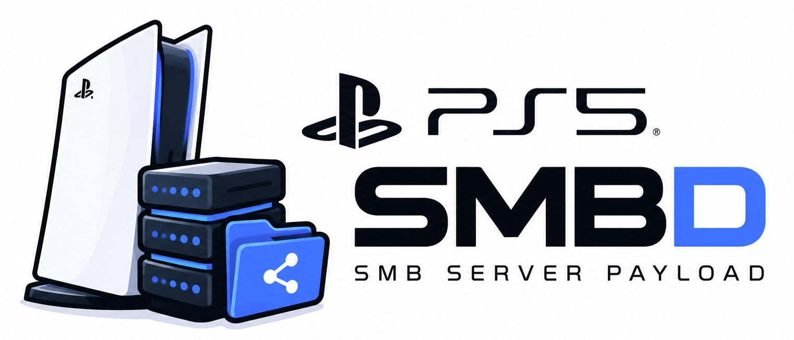
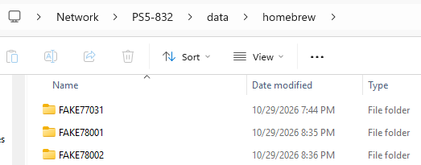

<p align="center"></p>

# ps5-smbd

The PS5's `/data` and `/mnt` as Windows shares, from a payload: `\\<console>\data` and `\\<console>\mnt`,
user `ps5`, password `ps5`, read and write.



Built on [libsmb2](https://github.com/sahlberg/libsmb2)'s SMB2/3 server, pinned to one commit of master and
patched (`patches/`), with the file system behind it in `src/fs.c`.

**Anyone on your network who knows the login can change or delete anything under `/data` and `/mnt`**:
saves, payload settings, passwords other apps keep there.

## Using it

1. Load `ps5-smbd.elf` like any payload (elfldr on port 9021: `nc -w 5 <ps5-ip> 9021 < ps5-smbd.elf`,
   or your payload manager). It shows up as `ps5-smbd.elf` in the console's process list.
2. In Windows, any of:
   - the console in Explorer's **Network** view (WS-Discovery);
   - `\\<console name>` in Explorer, the name as set in Settings > System (for example `\\PS5-832`);
   - `\\<ps5-ip>`, which lists the shares;
   - `net use Z: \\<console name>\data /user:ps5 ps5`.

   Log in as `ps5` / `ps5`.

The console answers its name over NetBIOS (UDP 137), LLMNR (UDP 5355) and mDNS (`<name>.local`, UDP 5353),
and announces itself over WS-Discovery (UDP 3702, metadata on TCP 5357). A port that is taken is skipped with
a line in the log; SMB on port 445 runs regardless.

Up to SMB 3.0.2, signed (Windows 11 requires signing and refuses guest logons, hence the login).

## Logs

- The payload's output goes to the kernel log (klogsrv shows it).
- A crash leaves one line in `/data/ps5-smbd/smbd.log`: `CRASH signal N at ...: rip main+OFFSET`. Look the
  offset up with `nm` on the same build.
- For a full trace of every request, create the file `/data/ps5-smbd/trace` and restart the payload; the
  trace goes to `/data/ps5-smbd/smbd.log`. Remove the file again afterwards: the trace writes a line for
  every request to the SSD.

## Building

```sh
export PS5_PAYLOAD_SDK=/opt/ps5-payload-sdk
make            # ps5-smbd.elf (fetches, patches and builds libsmb2 and libdcerpc on the first run)
make host       # the same server on this computer, port 4450, sharing build/data and build/mnt
```

`tools/build-libsmb2.sh` fetches libsmb2's archive of the pinned commit (checked by sha256), applies
`patches/libsmb2-*.patch` and builds both libraries into `.deps/`. To rebuild them after changing a patch,
remove `.deps/ps5/lib/libsmb2.a` (or `.deps/host/...`) first.

The tests in `tests/` are libsmb2 clients run against `make host`:

- `client.c`: write, read, rename, list, delete;
- `shares.c`: the share list;
- `notify.c`: change notify and cancel;
- `preauth.c`: raw requests out of turn: before a login (a cancel, a tree connect, a create first) they drop that client, not the server; a second session setup after a login is refused and the first session goes on;
- `cmac.c`: the signing's AES-CMAC against RFC 4493 and the portable code, over whole messages and in pieces, and its speed;
- `review.c`: what the code review found (pipe rename, failed compounds, wildcards, names that are not UTF-8, unknown set-info classes, FileAllInformation's name).

Libsmb2 itself has to be built with `-fsanitize=address` too for ASan to see its side of a bug.

## License

ps5-smbd's own code is under the GNU General Public License v3.0, see [LICENSE](LICENSE).

The payload links statically with:

- **libsmb2**: LGPL-2.1-or-later ([notice](third_party/libsmb2-COPYING),
  [text](third_party/libsmb2-LICENCE-LGPL-2.1.txt)). The patches in `patches/` are changes to libsmb2 and fall
  under its licence. To build the payload with your own libsmb2, change the commit in
  `tools/build-libsmb2.sh` or add a patch, and run `make`.
- **libdcerpc** from the same tree: BSD-2-Clause, Copyright (C) 2018 Ronnie Sahlberg
  ([notice](third_party/libdcerpc-COPYING)).
